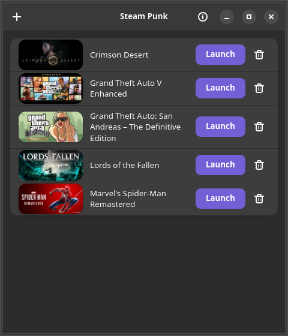

# Steam Punk

GTK4 + libadwaita desktop app for launching Windows game-trainer executables
(e.g. FLiNG trainers) through Proton against a currently running Steam
game's wine session, on Linux.

## Screenshot

The trainer list, with cover art from each trainer's Steam AppID. A running trainer shows a Running badge and a Stop button in place of Launch:



## How it works

The trainer is launched directly on the host — no Steam Linux Runtime
container, no umu-launcher:

```
<proton_dir>/proton runinprefix <trainer.exe>
```

with two environment variables set:

- `STEAM_COMPAT_CLIENT_INSTALL_PATH` — the Steam client install dir
- `STEAM_COMPAT_DATA_PATH` — `<library>/steamapps/compatdata/<appid>`

Because the game's wineserver socket lives under `/tmp`, which
pressure-vessel shares with the host, the trainer's wine client joins the
game's existing wineserver session and can see the running game process.
Under Flatpak Steam the game's `/tmp` is private to Steam's sandbox, so the same
command runs inside the sandbox with `flatpak enter <wineserver pid>` and joins
the game's wineserver there.

It works with native and Flatpak Steam, and with Proton 8 and older as well as
Proton 9 and newer and GE-Proton builds.

The trainer *must* be launched with the exact same Proton build whose
wineserver the game is currently running — a mismatch fails with
`wine client error: version mismatch`. This app detects that build from the
actual running `wineserver` process rather than trusting `compatdata`'s
`config_info`, which has been observed stale.

## Using it

1. Start the game, load past any menus.
2. Drag a trainer `.exe` onto the window (or use the + button) to import it.
   Importing copies the `.exe` into `~/.local/share/steam-punk/trainers/`, then
   asks which Steam game it is for: search by name or enter an AppID, or skip.
   That only sets the name and cover shown; to change it later, remove the
   trainer and import it again.
3. Click Launch on the trainer's row. A running trainer shows a Running badge
   and a Stop button in its place. The trainer goes into the running game's
   prefix: with no game running you are asked to start one first, and with
   several running you pick which one.

The trash button on a row deletes Steam Punk's copy of that trainer and its
AppID link at once.

Game names and cover art come from your local Steam install (including
Flatpak Steam) when available, and from the public Steam Store otherwise. On
import, the app suggests the installed game that matches the trainer's file
name. Online games with an anti-cheat get a warning the first time you launch a
trainer for them in each session, with Cancel or Launch Anyway
(single-player-only games never do): use trainers in single-player only. If a trainer dies right after launch, the likely cause
(game closed, different Proton build, missing .NET) is shown in a notification,
and the full log is at `~/.local/share/steam-punk/steam-punk.log`.

If the game's prefix doesn't have a real .NET Framework 4.6.2 or newer yet
(required by current WPF-based trainers, and never provided by Proton's
bundled wine-mono), the app offers a one-time setup. It first tries to copy a
working runtime from another game's Proton prefix in any of your Steam
libraries, which works with the game running. Otherwise it installs `dotnet48`
with `winetricks`, run with the game's own Proton wine. That installer needs the
game closed: the app asks you to quit the game, installs, then tells you to
start the game again and launch the trainer. The installer downloads about
200 MB the first time; a step that hangs is stopped after a time limit, and the
message names it. If winetricks or cabextract is missing and you choose the
automatic setup, they are installed after a password prompt on Debian/Ubuntu;
elsewhere the manual commands are shown. This modifies the game's Wine prefix:
it copies in the .NET runtimes and imports a `.reg` file, or, through
winetricks, installs `dotnet48` and sets the prefix to Windows 10.

## Requirements

The AppImage does not bundle GTK or libadwaita: it uses the host's, so the
system needs **GTK >= 4.12 and libadwaita >= 1.5**. Automatic one-time setup
(system packages for the .NET install) is Debian/Ubuntu-only and needs polkit
(`pkexec`); other distributions get the manual commands to run instead.

## Install, update and uninstall

Download `steam-punk-<version>-x86_64.AppImage` from
[Releases](https://github.com/labj1987/steam-punk/releases), make it executable
(`chmod +x`) and run it. The AppImage carries zsync update information, so
AppImageUpdate-compatible tools can update it in place.

The automatic setup installs `/usr/lib/steam-punk/privileged-setup.sh` and the
polkit policy `/usr/share/polkit-1/actions/io.github.labj1987.SteamPunk.setup.policy`,
installs `winetricks` and `cabextract` with apt, and logs to
`/var/log/steam-punk.log`.

To uninstall, delete the AppImage and `~/.local/share/steam-punk/`; if the
automatic setup ran, also remove `/usr/lib/steam-punk/`, that polkit policy and
`/var/log/steam-punk.log`.

## Building

```
./build-appimage.sh
```

Produces `steam-punk-<version>-x86_64.AppImage` (+ `.zsync` sidecar). Needs
cargo and the GTK 4 / libadwaita headers (installed with apt, through sudo, if
missing), `zsync` for the sidecar, and network access for the pinned
appimagetool and AppImage runtime it downloads.

## Non-goals

No trainer downloading/update-checking, no SLR/pressure-vessel/umu
integration, no per-game trainer database. (The app does modify a game's
prefix, but only to repair a missing .NET runtime, and only on request.)

## Acknowledgements

Development assistance: Claude Code (Anthropic) and Codex (OpenAI).

## License

AGPL-3.0-or-later. See [LICENSE](LICENSE).

Code at or before commit `0d97e95b89080c5b53efca8880abfd8834d3009a` remains available
under the MIT License per its original release. From this commit forward,
AGPL-3.0-or-later.

Linnard Alex Brown Jr.
